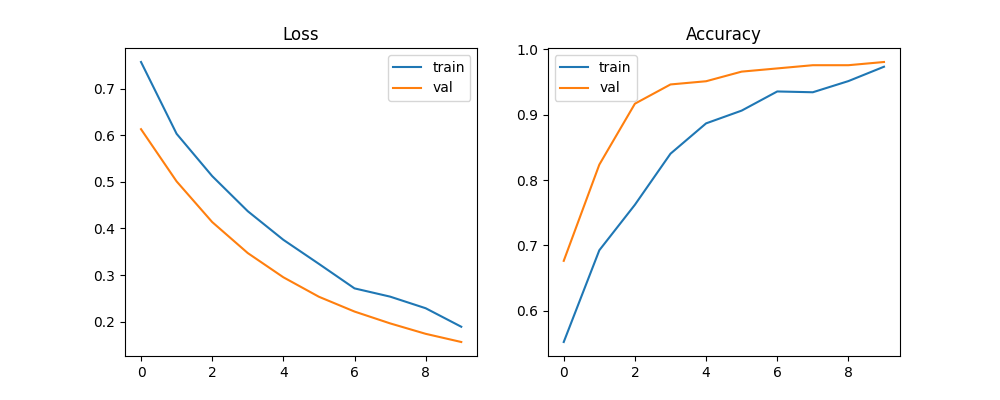
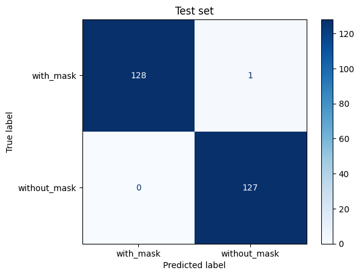

# COVID-19-Safe-Entry-System

Because of the mask and body temperature rules at public places, staff have to check every person by hand before letting them in.
Doing this manually is slow and mistakes happen easily.

This project is a smart entry system that checks the face mask and body temperature of a person, makes them sanitize their hands
and only then opens the door. It also keeps count of how many people are inside the building.

Our project is named "THE SENTINEL" - which means a guard who stands at the entrance and keeps watch.


## How it works

1. An IR sensor at the entrance detects a person standing at the check point.
2. The Pi Camera takes frames. OpenCV's SSD face detector finds the face and a MobileNetV2 model (TFLite) decides mask or no mask.
3. The MLX90614 reads the temperature. Anything above 37.5 C is refused.
4. The person puts a hand under the sanitizer. The HC-SR04 checks for a hand closer than 10 cm.
5. If everything passes the servo opens the door. An IR sensor in the doorway sees the person walk through and the door closes again.
6. An IR sensor on the inside opens the door for people going out.

The system refuses entry once `MAX_PEOPLE` are inside. Every check is saved in `logs/entries.csv`.

Buzzer:
- one beep for every check that passes
- two short beeps when the door opens
- three long beeps when entry is refused

## Hardware

- Raspberry Pi 4 Model B
- Pi Camera
- MLX90614 IR temperature sensor
- 3 IR obstacle sensors
- HC-SR04 ultrasonic sensor
- Servo motor for the door
- Buzzer

| Part | Pi pin (BCM) |
|---|---|
| IR at check point | GPIO 17 |
| IR in doorway | GPIO 27 |
| IR on the inside (exit) | GPIO 22 |
| HC-SR04 TRIG | GPIO 23 |
| HC-SR04 ECHO | GPIO 24 (through a voltage divider) |
| Servo | GPIO 18 |
| Buzzer | GPIO 25 |
| MLX90614 SDA / SCL | GPIO 2 / GPIO 3 |

Pins and limits can be changed in `config.py`.


## Files

| File | What it does |
|---|---|
| `sentinel.py` | Main program that runs on the Pi |
| `config.py` | Pins, temperature limit, timings |
| `mask_detector.py` | Face detection + mask model. Run it alone to test with a camera |
| `mask_model.tflite` | Trained mask model used on the Pi |
| `hardware_test.py` | Tests buzzer, servo, IR sensors, ultrasonic and temperature sensor one by one |
| `mlx90614_sensor_testing.py` | Prints readings from the MLX90614 to test the wiring |
| `get_face_detector.py` | Downloads the face detector weights into `face_detector/` |
| `split_dataset.py` | Splits the images into train and test folders and removes duplicate images |
| `train_mask_model.py` | Trains the mask model on a PC and saves `.h5` and `.tflite` |
| `evaluate_model.py` | Tests the `.tflite` model on the test images |
| `results/` | Training plot and confusion matrix |

## Mask model

### Dataset

We used the face mask dataset by Prajna Bhandary ([prajnasb/observations](https://github.com/prajnasb/observations), folder `experiements/data`).
It has 690 images with a mask and 686 without. 97 of them are exact copies of other images, so `split_dataset.py` removes those
before splitting. That leaves 644 with mask and 635 without, split 80 / 20 into train and test.

```
python split_dataset.py --source observations/experiements/data
```

### Training

Done on a PC, not on the Pi. MobileNetV2 trained on ImageNet is used as the base and only the new top layers are trained
(10 epochs, Adam, learning rate 0.0001). 20% of the train images are used for validation.

```
pip install -r requirements-train.txt
python train_mask_model.py --epochs 10
```

This saves `mask_model.h5` (not kept in the repo), `mask_model.tflite` and `results/training_plot.png`.
The TFLite model is saved with float16 weights. The default 8 bit version was smaller but took over a second per image.



### Results

`evaluate_model.py` runs the `.tflite` model on the 255 test images that were never used in training.

```
python evaluate_model.py
```

| | Precision | Recall |
|---|---|---|
| with_mask (128 images) | 1.000 | 0.953 |
| without_mask (127 images) | 0.955 | 1.000 |

Test accuracy: **97.65%** (249 of 255).
No person without a mask was classified as wearing one. 6 people with a mask were classified as no mask, so they would be asked to try again.



The masks in the "with mask" images of this dataset were added to normal face photos, so they all look alike.
Real masks of other colours and shapes can give lower accuracy. Adding real photos to `dataset/train` and training again will help.

## Running on the Raspberry Pi

1. Enable I2C and the legacy camera in `sudo raspi-config`.
2. Install the libraries:
   ```
   pip3 install -r requirements.txt
   ```
3. Download the face detector weights:
   ```
   python3 get_face_detector.py
   ```
4. Test the parts:
   ```
   python3 hardware_test.py
   python3 mask_detector.py
   ```
5. Compare the MLX90614 reading with a normal thermometer and set `TEMP_OFFSET` in `config.py`.
   The sensor reads skin temperature, which is lower than body temperature.
6. Start the system:
   ```
   python3 sentinel.py
   ```

Press Ctrl+C to stop. The door closes and the GPIO pins are cleaned up.

## Prototype


